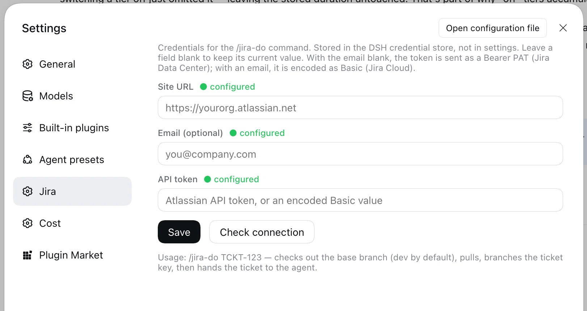

# dsh-plugin-jira

Jira ticket intake for [DeepSeek Harness](https://github.com/deepseek-ai/deepseek-harness) (`dsh`), built against dsh 0.2.x.

- **Settings → Jira** — store the site URL, email and API token; its **Check connection** button runs `/jira-check` in the current session.
- **`/jira-do TCKT-123`** — fetches the issue, checks out the base branch (`dev`, or `base` from `.dsh-jira.json`), pulls, creates the branch from the configured template (default `TCKT-123`), downloads attachments into `docs/jira/TCKT-123/`, then hands it to the agent with the richness of the ticket (components, fix versions, environment, parent/epic, subtasks, configured custom fields, full comment thread) and a fix brief (root cause, minimal change, tests, a full change report at `docs/jira/TCKT-123.md`, no commit).
- **`/jira-check`** — shows which account the token authenticates as and which projects it can see; a 401 is reported with the exact fix.
- **`/jira-find [JQL]`** — searches Jira; with no input it lists your open issues.
- **`/jira-transition TCKT-123 [status]`** — lists the allowed transitions, or moves the ticket to the matching transition/destination status.
- **`/jira-comment [TCKT-123] text`** — posts a comment; the key is taken from the current branch when the branch is a ticket key, so `/jira-comment Fixed in this branch` is enough. **Attach screenshots** in the composer and they are uploaded to the issue and embedded in the comment. **Omit the text** (e.g. `/jira-comment` on `TCKT-123`) and the agent analyzes all the branch's changes — committed since the base branch plus the working tree — and writes the comment itself.
- **`/jira-mr [target]`** / **`/jira-pr [target]`** — open a GitLab merge request or GitHub pull request from the ticket branch to `target` (default `dev`), using `docs/jira/<KEY>.md` for the ticket link, root-cause summary and test plan. Both commands detect the provider from `origin`.
- **`jira_ticket` tool** — fetch one issue (summary, description, status, labels, components, fix versions, environment, parent/subtasks, attachments, full comment thread) without touching git.
- **`jira_search` tool** — JQL search (max 50), read-only.
- **`jira_transition` tool** — list or apply workflow transitions; writes to Jira.
- **`jira_comment` tool** — post a comment (progress, findings, completion), optionally with local image paths via `attachments`; images are uploaded and embedded.

```
package.json      dsh.bundle.patch + dsh.client (platform: web); exports "." and "./client"
cordis.patch.yml  insert row  id: jira → dsh-plugin-jira
index.js          host entry: apply() wires the modules below
lib/config.js     credential refs, auth header, rejected-credential hint
lib/requests.js   GitHub PR / GitLab MR creation from the change report
lib/repo.js       .dsh-jira.json: base, branch template, worktree, dirty guard, field IDs
lib/attachments.js  download/upload attachments; composer images → comment media
lib/adf.js        Markdown → Atlassian Document Format
lib/jira.js       REST v3 (issues, comments, search, transitions), rich rendering, /jira-check
lib/git.js        branch/worktree prep, dirty guard, branch diff and status
lib/prompts.js    agent hand-off prompts
lib/commands.js   /jira-do, /jira-check, /jira-find, /jira-transition, /jira-comment
lib/tools.js      jira_ticket, jira_search, jira_transition, jira_comment
client.js         browser half: the settings page, in window.__ModuleLoader__ format
test.js           offline self-check: branch prep, hand-off, tools, comments, client registration
```

## Install

Published package:

```sh
dsh plugin --profile web add dsh-plugin-jira
dsh web --dump-config | grep 'id: jira'   # confirm the layer mounted
# restart dsh web
```

From the repo (also what the Desktop **Plugins → install** dialog takes):

```sh
dsh plugin --profile web add github:angelomadara/dsh-plugin-jira
```

Local development:

```sh
dsh plugin --profile web add link:/absolute/path/to/dsh-plugin-jira
```

Then open **Settings → Jira** and store the site URL, email and API token. Remove it from the Plugins page, or `dsh plugin --profile web remove dsh-plugin-jira` and delete the `jira` row from the profile's `cordis.patch.yml`.

## Create a Jira API token

### Jira Cloud

1. Sign in to your Atlassian account.
2. Open **Account Settings → Security → Create and manage API tokens** — <https://id.atlassian.com/manage-profile/security/api-tokens>.
3. Click **Create API token**, name it (for example `DSH Jira`), then **Create**.
4. Copy the token right away — Atlassian shows it only once.
5. In DSH open **Settings → Jira** and fill in:
   - **Site URL** — `https://yourorg.atlassian.net`
   - **Email** — the Atlassian account that owns the token
   - **API token** — the value you copied

   Click **Save**, then **Check connection**. It should report your account and the projects the token can see.



### Jira Data Center

1. Open your avatar → **Account settings** (or **Profile**) → **Personal Access Tokens** → **Create token**.
2. Copy the token.
3. In DSH **Settings → Jira**, set the **Site URL** (include a context path such as `https://jira.example.com/jira` when your instance uses one), leave **Email** blank, paste the token, then **Save** → **Check connection**.

The token lives in the DSH credential store, never in this repository or the settings files. **Check connection** runs `/jira-check` in the current session, so its result also appears in that conversation.

For `/jira-mr`, GitLab authentication comes from `GITLAB_TOKEN` (DSH credential store or environment) or the git credential helper for that host. `/jira-pr` uses the authenticated `gh` CLI.

## Credentials

The page writes three credential references: `JIRA_SITE`, `JIRA_EMAIL`, `JIRA_API_TOKEN`. Env vars of the same names also resolve, so CI/headless can skip the page.

- `JIRA_EMAIL` + `JIRA_API_TOKEN` → encoded into `Basic` auth (Jira Cloud API token).
- `JIRA_EMAIL` blank → `JIRA_API_TOKEN` is sent as `Bearer` (Jira Data Center PAT), unless it already starts with `Basic `.

The site URL must be `https` (plain `http` is allowed only for localhost), so the token never travels in cleartext.

## Repo config

Optional `.dsh-jira.json` at the repository root:

```json
{
  "base": "develop",
  "branch": "feature/{key}-{slug}",
  "worktree": false,
  "allowDirty": false,
  "downloadAttachments": true,
  "provider": "gitlab",
  "fields": {
    "acceptanceCriteria": "customfield_10001",
    "storyPoints": "customfield_10002",
    "severity": "customfield_10003",
    "epic": "customfield_10014"
  }
}
```

- `base` — branch to branch from (default `dev`).
- `branch` — template with `{key}` and `{slug}` (default `{key}`).
- `worktree` — create `.dsh-jira-worktrees/<branch>` instead of switching the current checkout; `/jira-comment` finds it by ticket key.
- `allowDirty` — allow switching with tracked changes (default false; untracked files never block).
- `downloadAttachments` — download attachments into `docs/jira/<KEY>/` (default true, 10 MB per file).
- `fields` — friendly label → Jira custom field id; rendered in the brief.
- `provider` — `github` or `gitlab` when the remote host name does not contain it (self-hosted GitHub/GitLab).

`/jira-mr` and `/jira-pr` require tracked changes to be committed and `docs/jira/<KEY>.md` to be committed; they push the branch before opening the request. Untracked files are allowed but reported as not included. `/jira-do` reuses an existing branch and reports how many commits ahead it is. Issue-type briefs add specific focus: bug (root cause + repro), story (acceptance criteria), spike (options/recommendation).

## Check

```sh
node test.js   # ok — command, branch, hand-off, tools, comments, client registration
```

Notes: after the fix, the agent must write the full change report to `docs/jira/<KEY>.md` — ticket URL and summary, severity/impact, root cause, every changed file and why, verification commands and results, risks and follow-ups — and treat it as part of the deliverable. Comments are posted as Atlassian Document Format (REST v3): blank lines become paragraphs, single newlines hard breaks, and `**bold**`, `*italic*`, `` `code` ``, `[links](url)`, `-`/`1.` lists and fenced code blocks are converted; the whole comment thread is fetched in pages (capped at 200) rather than trusting the issue field. `/jira-comment` without text hands the ticket branch's diff and `git status` to the agent (60k-char diff cap; the agent can run git for the rest) and asks it to post one summary comment. `/jira-do` fetches the ticket **before** touching git, so an unknown or unreachable key never leaves a new branch behind. Branch prep is `checkout <base>` → `pull --ff-only` → `checkout -b <KEY>` (base defaults to `dev`; set `{ "base": "develop" }` in `.dsh-jira.json` at the repo root to override; an existing branch is reused); a failed pull is reported in the command reply, not fatal. The agent is instructed not to commit or push.

## License

MIT
